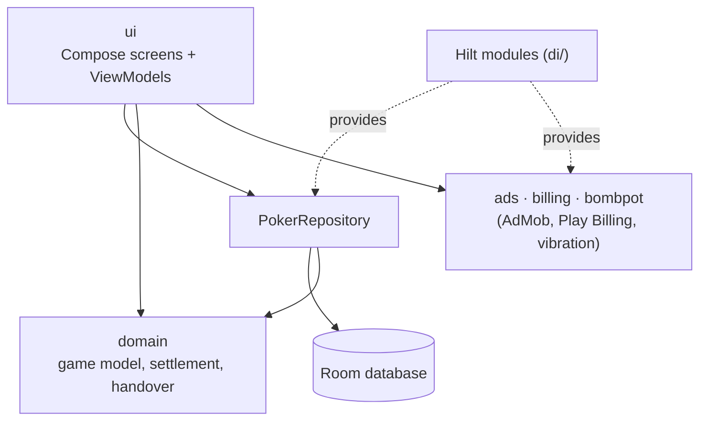

<p align="center">
  
</p>

<h1 align="center">Homepoker Cashier</h1>

<p align="center">
  An Android app that works as the bank for a home cash game: buy-ins, rebuys and cash-outs during the night, then who pays whom at the end.
</p>

<p align="center">
  
  
  
</p>

<!-- TODO: uncomment once the app is live on Google Play, and check that the link opens its page.
<p align="center">
  <a href="https://play.google.com/store/apps/details?id=com.zango.pokertracker">
    
  </a>
</p>
-->

## About

Homepoker Cashier keeps the books for a home poker cash game. The host records every buy-in, rebuy, chip sale and cash-out as the night goes on. At the end the app checks the chip counts against the money that came in, then works out the payments that settle everyone up. It started as a tool for my own games and is now available on [Google Play](https://play.google.com/store/apps/details?id=com.zango.pokertracker).

All game data stays on the phone. There is no account and no server. Games move between phones only when a host hands one over by QR code or file.

## Screenshots
<table>
  <tr>
    <td></td>
    <td></td>
    <td></td>
    <td></td>
  </tr>
</table>

## Features at a glance

- **Game setup.** Set the blinds by hand or pick from a list of common stakes. Chip value can be worked out from the chip markings. The buy-in can be set in big blinds or cash, with per-player overrides and an optional random seating order.
- **Live game.** Record rebuys, cash-outs and chips sold back to the bank, with undo. Players can join mid-game, and seats can be swapped on a table view. The screen also shows elapsed time and total buy-ins.
- **End of game check.** Enter the final chip counts. The app shows whether every chip is accounted for, or how many are missing or extra.
- **Settlement.** A short list of "A pays B" payments, rounded to the smallest note or coin you use. Any rounding difference is shown. Share the list with a picture of the results, or copy it, and mark each payment as paid.
- **Side games.** A bomb pot timer on the game screen: a countdown, and a full-screen announcement with a vibration when one is due. It runs while the app is open; nothing is sent when it is closed. There is also a firetruck tracker (three pots in a row).
- **Game handover.** Pass a running game to another host's phone with a QR code, or as a file when the game is too big for one code.
- **History sharing.** Export finished games to another phone, or import someone else's, by QR code or file. Players with the same name are merged so their results add up.
- **Player roster and stats.** Profit over all games, games played and buy-ins for each player, with sorting and filters. Players can be renamed or hidden without changing past results.
- **Localization.** English, Russian, Spanish, German and French, with an in-app language switch and a choice of currency symbol.
- **Ads with a way out.** Banner and interstitial ads, with consent handled through Google's User Messaging Platform. A one-time in-app purchase removes them.

## Features in detail

This section walks through the app screen by screen and names every important button as it appears in the English version. Button names are in **bold**.

### How a night goes

1. The host opens the **Game hub** and taps **New game → Create new game**.
2. They set the blinds, the chip value and the buy-in, pick the players and tap **Start game**.
3. During the night they record rebuys, chip sales and cash-outs on the **live game** screen.
4. At the end they tap **End game**, count the chips left on the table and tap **Finish and settle up**.
5. The **Settlement** screen shows who pays whom. The host shares the list in the group chat and ticks off payments as they are made.

### Navigation menu

The **☰** button in the top-left corner of the Game hub, Players and Settings opens a side menu. It shows the tagline *"The bank for your home game"* and four items:

- **Cash games**: the Game hub.
- **Tournaments**: marked **Coming soon**. Not available yet.
- **Players**: the roster and stats.
- **Settings**.

### Game hub

The screen the app opens on. Games are split into two lists:

- **Still running**: games that have not finished, marked with a **RUNNING** badge. Tapping one goes back into the live game.
- **Finished**: past games. A game where every payment has been ticked off gets a **PAID UP** badge. Tapping one opens its settlement.

Each row shows the game name, the date, the number of players and buy-ins. The **⋮** button on a row opens **Delete game**. The confirmation says how many players and buy-ins go with the game and that this cannot be undone. **Keep it** cancels. Players stay on the roster.

Two round buttons sit at the bottom of the screen:

- **New game** (green, bottom right) opens two options:
  - **Create new game**: opens the game setup screen.
  - **Load a game**: takes over a game that another host handed over (see [Game handover](#game-handover)). Choose **Scan QR code** or **Open a file**, check the game name and start time, then tap **Take over**. If the phone already has a copy of the game, it is replaced.
- **Share** (grey, bottom left) opens two options:
  - **Export**: sends finished games to another phone (see [Sharing game history](#sharing-game-history)).
  - **Import**: receives games another host exported.

A banner ad is shown at the bottom of the screen.

### New game

The setup form is split into sections.

**Identity**
- **Game name**: up to 25 characters.

**Stakes**
- **Small blind** and **Big blind** fields.
- **COMMON STAKES** bar under the fields. Tapping it opens a list of saved blind levels; picking one fills in both blinds. The bar says **Custom** when the typed blinds are not in the list. Any new level that is played is added to the list automatically (up to 10 levels).
- **Work the chip value out from the markings** switch. On: enter **Big blind, in chips** and the app calculates the value of one chip. For example, chips marked 1 and 2 on a 0.005 / 0.01 table make one chip worth 0.005. Off: enter the **Cash value of one chip** directly.
- A line under the section shows **One chip is worth** the resulting amount.

**Buy-in**
- **Big blinds / Cash** switch: the standard buy-in can be entered as a number of big blinds (100 BB by default) or as a cash amount.
- A preview shows **Every player starts with** the chips and cash it converts to. If the buy-in does not convert into a whole number of chips, the app says how much is left over.

**Payout rounding**
- **Round payments to**: the smallest note or coin players will hand each other. Settlement payments are rounded to it.

**Side games** (optional)
- **Bomb pot** switch with **Every, in minutes** (30 by default, up to 24 hours). The game screen then shows a countdown timer.
- **Firetruck** switch: a tracker for one player winning three pots in a row.

**Players**
- Tap a player on the roster to add them to the game, tap again to drop them. A counter shows how many are playing.
- **Add someone new**: type a name (up to 12 characters) and tap **Add player to the roster**.
- The buy-in shown on a selected player can be tapped to change it for that player only. The dialog has **Set** and **Use default**. A changed buy-in is marked **OVERRIDE**.
- **Random player order** switch: seats everyone in a random order when the game starts (up to 9 players). The table then appears on the live game screen.
- **On the table at kick-off** shows the total cash and chips that will be in play.

**Start game** at the bottom creates the game and opens the live game screen. A banner ad is shown at the bottom of the screen.

### Live game

The top bar shows the game name, **←** back to the Game hub and **End game** on the right. If the game has side games, two tabs appear under the top bar: **Stats** and **Game**.

**Stats tab**
- Summary tiles: **Elapsed** (a live timer), **Buy-ins** (total cash in) and **Blinds**.
- **Table** (only with random player order): a drawing of the poker table with every player in their seat. Tap two players to swap their seats.
- **At the table**: one card per player still playing. It shows **In for** (cash put in) and **Sold back** (chips sold back to the bank). Buttons on the card:
  - **Rebuy**: enter an amount, tap **Add**.
  - **Sell chips back to the bank**: the player hands some chips back and takes cash for them, but keeps playing. Enter **Chips returned**, tap **Record**. The app will not accept more chips than are on the table.
  - **Undo last**: cancels the last chip sale.
  - **Cash out**: the player leaves. Enter the **Final chip count**, tap **Cash out**.
- **Cashed out**: players who have left, with **Out with** and **Net** (profit or loss). **Undo cash-out** puts a player back at the table.
- **On the table**: how many chips are in play and how many were bought back by the bank.

**Game tab** (only if side games were turned on)
- **Bomb pot**: **Next bomb pot in** countdown, and how often it repeats. When the time comes, the whole screen shows **BOMB POT!** with confetti and the phone vibrates. **Tap anywhere to close.** The timer only runs while the app is open; there are no notifications.
- **Firetruck**: a list of players. Tap whoever wins each pot. Each win adds a dot; someone else winning clears the dots. Three in a row shows **FIRETRUCK!** on the whole screen.

**Bottom buttons**
- **Hand over** (grey, bottom left): passes the game to another phone (see [Game handover](#game-handover)).
- **Add player** (green, bottom right, Stats tab): a late player joins. Pick someone **From the roster** or type a name under **Or add someone new**, enter their **Buy-in** and tap **Seat them**.

A banner ad is shown at the bottom of the screen.

### End game

Opened by **End game** on the live game screen.

- **Chip counts**: one card per player. Players still at the table need a **Final chips** count. Players who cashed out earlier are already filled in. Chips sold back during the night are added on top automatically. If the counts already add up, players left uncounted are recorded as 0 (**Empty — recorded as 0**).
- **Results**: a headline that says either **Every chip is accounted for**, or how many chips are missing or extra and what they are worth. Below it: **Bought in**, **Counted** and **Difference**. If the numbers do not match, a warning asks the host to re-count.
- A results table with columns **Player**, **In**, **Chips**, **Out**, **Net**.
- **Finish and settle up** ends the game. If the chips do not add up, a dialog warns that someone will end up short and offers **Re-count** or **Finish anyway**.
- For a game that has already finished, the button reads **View settlement**.

After the game ends, a full-screen ad may appear on the way to the settlement (see [Ads and the Remove ads purchase](#ads-and-the-remove-ads-purchase)).

### Settlement

The result of the night.

- **The night**: summary tiles **Buy-ins**, **Lasted** (how long the game went on) and **In the bank**.
- **Payments**: the shortest list of "*A* pays *B* amount" lines that squares everyone up. Tap a payment to tick it off as paid. A counter shows "*2 of 5 paid*", and the screen says **Not fully settled** until all are ticked. If everyone broke even, the screen says so.
- Notes under the list explain any rounding ("*Rounded to the nearest 1. Alex absorbed 0.40.*") and any chip mismatch.
- **Results**: the same five-column table as on the End game screen.
- **Share**: sends the payments to any app, for example the poker group chat. The text starts with "*Game name* — settlement", puts each "*A* pays *B* amount" on its own line with a blank line between them, and ends with "Settlement was made via Homepoker Cashier - check it out on Google Play!" and a link to the app on Google Play. A picture of the Results table goes with it: the game name, the table, and the app name with the app logo in the bottom right corner. Apps that only take text get the text alone.
- **Copy**: copies the same text to the clipboard, without the picture.
- **Back to history** returns to the Game hub.

Right after a game ends, while ads are still on, a dialog may ask for a small donation: **Enjoying Homepoker Cashier?** with **Donate now** and **No, thanks**. If a full-screen ad has just been shown, the dialog reads **Tired of ads like that one?** instead. **Donate now** opens the Remove ads purchase in Settings. The dialog is shown once per finished game and never to someone who has already paid.

### Game handover

Lets a second host take over a running game on their phone, for example when the first host leaves early.

1. On the live game screen, tap **Hand over**. A QR code with the whole game appears.
2. On the other phone: **New game → Load a game → Scan QR code**, then **Take over**.
3. If the game is too big for one QR code, use **Send as a file** (or **Send as a file instead**) and open the file on the other phone with **Load a game → Open a file**.
4. Tap **Done, it is handed over**. The app asks whether to **Remove it** from this phone or **Keep a copy**.

No server is involved. The data goes straight from one phone to the other.

### Sharing game history

Moves finished games between phones, for example so that two hosts of the same group have the same history and stats.

- **Export** (Game hub → **Share**): pick **All games** or **Choose games**, then tap **Export N games**. The app shows a QR code, or offers a file when the games do not fit in one code. **Done** closes the screen.
- **Import** (Game hub → **Share**): scan the QR code or open the file. A confirmation says how many games will be imported, how many are already on the phone and will be skipped, and how many new players will join the roster. Players with the same name as someone on the roster are joined to them, so their results add up. Tap **Import**.

### Players

The roster of everyone who has played.

- Each row shows the player's name, all-time profit or loss, the number of games and buy-ins. New players show **Never played**.
- **Add player** (green button, bottom right): enter a name and tap **Add**.
- **Sort and filter** (top right) opens a menu:
  - **Sort by**: **Name A–Z**, **Name Z–A**, **Biggest winnings**, **Smallest winnings**, **Most games**, **Fewest games**.
  - **Show**: **Only players with a game**, **Hidden** (shows hidden players, who are left out of the list by default).
- **⋮** on a row:
  - **Rename**: past games show the new name too.
  - **Remove from roster** (for players with games): hides the player from new games without touching their results. Confirm with **Hide**.
  - **Delete player** (for players who never played): removes them completely.
  - **Show in new games**: brings a hidden player back.
- Tapping a player opens their record.

### Player record

- **All-time profit** in large figures, with the number of games and how many of them they finished up.
- Tiles: **Paid in**, **Buy-ins**, **Cashed out**.
- **Every game**: the list of their games with the date, buy-ins and the result. Running games show **Still playing**. A note says how many games are still to be settled; they are not counted in the total.

### Settings

- **Blind sizes**: the saved levels offered on the New game screen ("*4 of 10*"). **Add blinds** adds a level; the **×** on a level removes it.
- **Currency**: **Choose currency** opens a searchable list. The symbol is shown next to every cash amount; changing it does not change any figures. USD by default.
- **Language**: English, Русский, Español, Deutsch, Français. The app restarts to switch; games and players are not affected.
- **Remove ads**: the **Remove ads · price** button buys the one-time purchase. Ads are removed for good, including on a new phone signed in to the same Google account. While Google Play is confirming a payment, the section says the payment is pending.
- **Privacy**: **Privacy policy** opens the policy in the browser. **Privacy options** (only in regions where the law requires it) lets the user choose again whether ads may be personalized.
- **About**: **Developer website**, **Write a review** (opens the Google Play page) and **Contact support** (opens an email). The app version is shown at the bottom.

### Ads and the Remove ads purchase

| Placement | Type | When |
| --- | --- | --- |
| Game hub | Banner | Bottom of the screen, always |
| New game | Banner | Bottom of the screen, always |
| Live game | Banner | Bottom of the screen, always |
| End of a game | Full-screen (can be video) | When the host taps **Finish and settle up**, before the settlement opens |
| Leaving a paid-up settlement | Full-screen | When the host goes back to the Game hub from a game where every payment is ticked off |

- Full-screen ads are capped at one per 3 finished games across both slots. They only appear at breaks between tasks, never while the host is typing.
- Consent for personalized ads is asked through Google's User Messaging Platform where the law requires it, and can be changed in **Settings → Privacy options**.
- The **Remove ads** purchase (Settings, or **Donate now** in the donation dialog) turns off all banners and full-screen ads for good.

### Languages and currency

The whole app is translated into English, Russian, Spanish, German and French. Any currency symbol can be chosen in Settings. Amounts are always calculated exactly (no rounding errors), and the settlement is rounded only to the unit chosen under **Payout rounding**.

## Tech Stack

- **Language:** Kotlin 2.0.21, JVM target 17
- **UI:** Jetpack Compose, Material 3, Navigation Compose, single activity
- **Architecture:** MVVM (ViewModel + `StateFlow` UI state), layered into `ui` / `domain` / `data`
- **DI:** Hilt 2.52 (KSP)
- **Storage:** Room 2.6.1 (schemas exported to `app/schemas/`), SharedPreferences for small UI state
- **Async:** Kotlin Coroutines and Flow
- **Game handover:** kotlinx.serialization, ZXing (QR generation), Google Code Scanner (QR scanning)
- **Monetization:** Google Mobile Ads (AdMob), User Messaging Platform, Play Billing 9
- **Testing:** JUnit 4, kotlinx-coroutines-test, Turbine

<details>
<summary>Build configuration</summary>

| Setting | Value |
| --- | --- |
| `applicationId` | `com.zango.pokertracker` (debug builds add `.debug`) |
| `versionName` | 1.2.8 |
| `minSdk` / `targetSdk` / `compileSdk` | 26 / 36 / 36 |
| Android Gradle Plugin | 8.13.2 |
| Gradle | 8.13 (wrapper) |
| Compose BOM | 2025.09.01 |

All dependency versions are listed in [`gradle/libs.versions.toml`](gradle/libs.versions.toml).

</details>

## Architecture

The app is a single Gradle module with three layers. `ui` holds one package per screen, each with a Compose screen, a ViewModel and a UI state class. `domain` holds plain Kotlin: the game model, chip and money arithmetic, reconciliation, settlement and the handover format. `data` puts Room DAOs behind a `PokerRepository` interface. Money and chips have their own value types (`core/money`) instead of floating-point numbers, so settlement results are exact.



## Building from Source

### Requirements

- Android Studio 2026.2.1 Canary 5 (the version the project is developed in)
- JDK 17 or newer to run Gradle. The Gradle daemon asks for JetBrains JDK 21 and downloads it automatically if it is missing.
- Android SDK Platform 36

### 1. Clone

```bash
git clone https://github.com/Zangormo/homepoker_tracker.git
cd homepoker_tracker
```

### 2. Create `local.properties`

Copy the template:

```bash
cp local.properties.example local.properties
```

Then edit it:

- `sdk.dir`: path to your Android SDK. Android Studio fills this in on its own.
- `RELEASE_STORE_FILE`: **required, even for debug builds.** The release build type looks up its signing config during Gradle configuration. If this key is missing, every task fails with `SigningConfig with name 'release' not found`. For a debug build, any path works and the file does not have to exist.
- `RELEASE_STORE_PASSWORD`, `RELEASE_KEY_ALIAS`, `RELEASE_KEY_PASSWORD`: only needed to sign a release build with your own keystore.
- `ADMOB_*`: the real AdMob IDs, used only by the release build. A debug build ignores them and always uses Google's public test ad IDs, so it never shows real ads. A release build fails if any of them is missing.

Each of these keys can also be passed as an environment variable with the same name. Never commit `local.properties` or a keystore. Both are git-ignored.

No `google-services.json` is needed. The app does not use Firebase.

### 3. Build and install a debug APK

```bash
./gradlew assembleDebug
```

The APK is written to `app/build/outputs/apk/debug/`. The debug build uses the package name `com.zango.pokertracker.debug`, so it installs next to the Play Store version instead of replacing it.

### Tests and release checks

```bash
./gradlew testDebugUnitTest
```

Unit tests live in `app/src/test/`. They cover money and chip arithmetic, settlement, Room migrations, the handover format and the ViewModels.

```bash
./gradlew verifyRelease
```

`verifyRelease` runs the release unit tests and lint (lint treats warnings as errors), then builds the minified, signed release bundle. It needs a real keystore.

## Permissions

| Permission | Why |
| --- | --- |
| `INTERNET`, `ACCESS_NETWORK_STATE` | Loading ads. Game data never leaves the device. |
| `AD_ID` and `ACCESS_ADSERVICES_*` | Added by the Google Mobile Ads SDK for ad delivery and measurement. Personalization follows the consent you choose in Settings > Privacy options. |
| `com.android.vending.BILLING` | The one-time "Remove ads" purchase. |
| `VIBRATE` | Vibrates when the open game announces a bomb pot. |
| `WAKE_LOCK`, `FOREGROUND_SERVICE` | Added by Google Play services libraries. |

The app does not ask for camera access. QR scanning uses Google's Code Scanner, which runs outside the app. App data is excluded from cloud backup and from device-to-device transfer.

Privacy policy: <https://zangormo.github.io/poker_cashier_privacy_page/>

## License

This project has no open-source license. The code is published for reference only, and all rights are reserved.

## Author

Ilja Birjukov <br>
Personal website: https://zangormo.github.io/ <br>
Github: https://github.com/Zangormo <br>
LinkedIn: https://www.linkedin.com/in/ilja-birjukovs/ <br>
E-mail: birjukovs06@gmail.com

